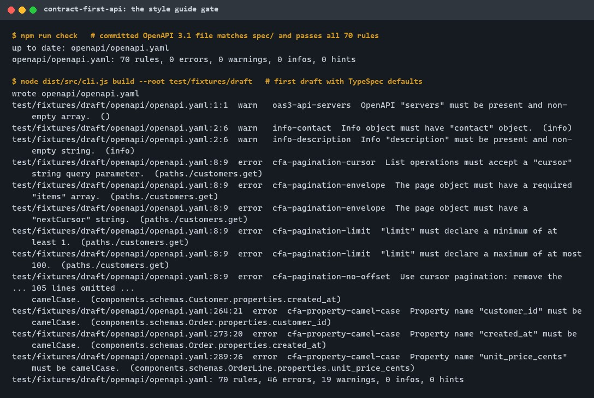
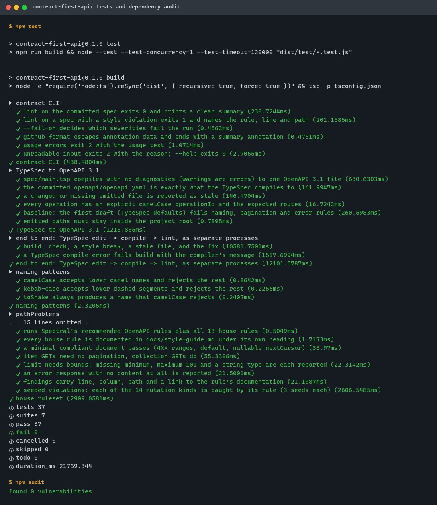
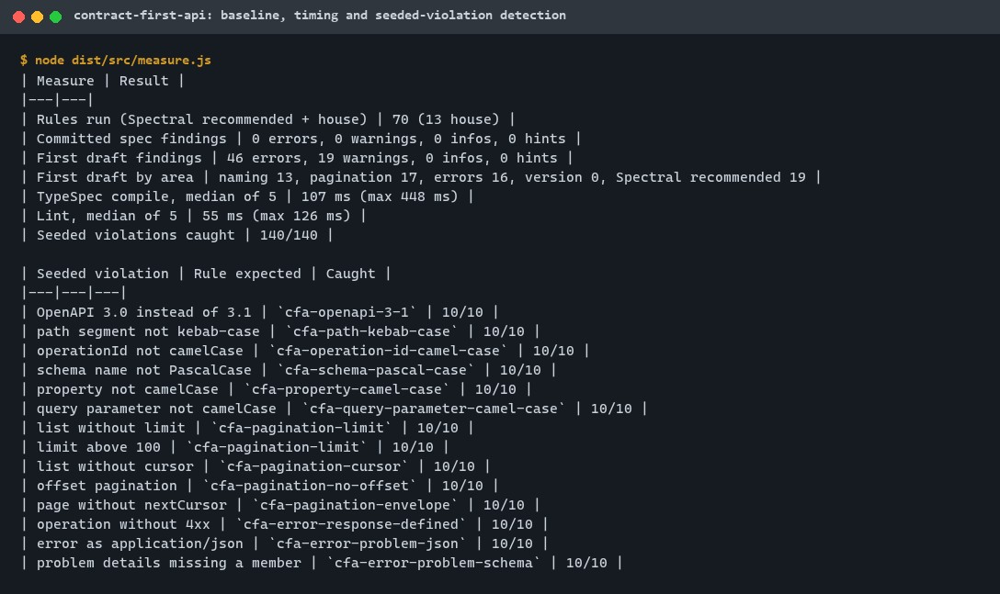
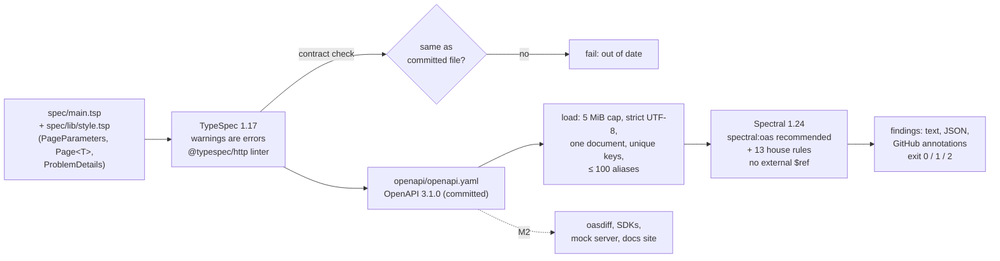
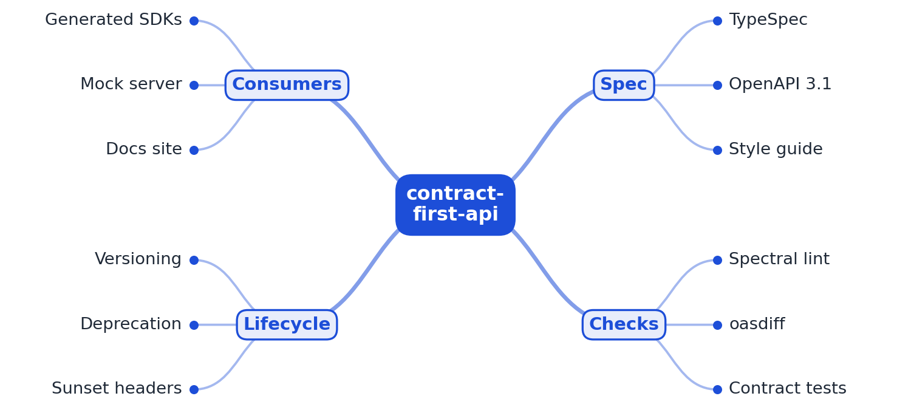
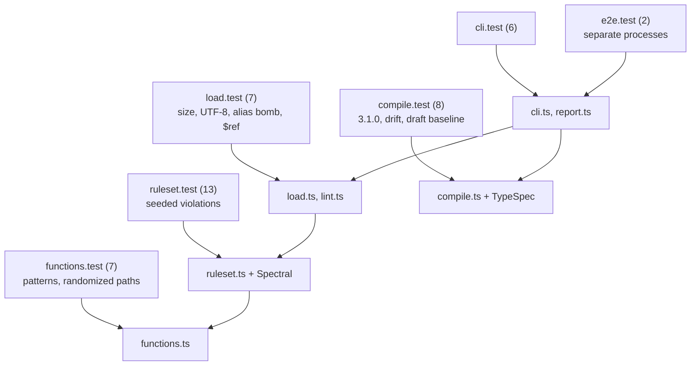

# contract-first-api

[](https://github.com/EquinoxWN/contract-first-api/actions/workflows/ci.yml)


> Stops an API change breaking every client: design the spec first, block breaking changes in CI, generate the SDKs and docs.

Part of my **Backend and API** list · TypeScript · TypeSpec

## Proof it works

`npm run check` compiles the TypeSpec, confirms the committed OpenAPI 3.1 file is identical to it,
and lints it with 70 Spectral rules (13 of them the house style guide): 0 errors, 0 warnings. The
first draft of the same API, written with TypeSpec defaults, fails with 46 errors and 19 warnings:



`npm test` runs 43 tests (unit, randomized, seeded-violation, CLI and end-to-end), and the
dependency audit is clean:



`make bench` measures compile and lint time and checks that 140 seeded style violations
(14 kinds, 10 seeds each) are all caught:



## Architecture

**What M1 runs today:**



**Full roadmap (M1 to M3):**



## How it works

_Steps 1 and 2 are built and tested (M1); the rest is on the [roadmap](#roadmap)._

1. The API is designed in TypeSpec and compiled to OpenAPI 3.1.
2. Spectral enforces the style guide: naming, pagination, error format.
3. oasdiff compares the spec with the last release and fails CI on breaking changes.
4. SDKs, a mock server and a docs site are generated on every release.
5. Contract tests check that the running server matches the spec.
6. Deprecated endpoints return Deprecation and Sunset headers.

In M1 the example is an Orders API (customers and orders of a small shop, 8 operations). The
[style guide](docs/style-guide.md) lists each rule; every finding links to its section.

## Who it helps

- **API designers and backend teams** who want to agree on the contract before writing handlers:
  they edit about 290 lines of TypeSpec (two files) instead of the 519-line OpenAPI YAML it produces, run `make spec`, and review
  the generated OpenAPI diff in the same pull request.
- **Platform teams** who want one API style across many services: the 13 house rules (camelCase
  fields and operationIds, kebab-case paths, cursor pagination with a bounded `limit`, RFC 9457
  problem details for every error) run as a CI gate with line-level annotations, so style review
  stops being a manual comment thread.
- **Client and SDK teams**, who get consistent names, one pagination pattern and one error format
  to code against, and a spec that cannot silently drift from the design (`make check` fails if
  the committed file differs from the TypeSpec).
- **Anyone with an existing OpenAPI 3.1 file:** `contract lint path/to/openapi.yaml` checks it
  against the same rules without adopting TypeSpec.

## Tech stack

| Area | In M1 | Planned |
|---|---|---|
| Spec | TypeSpec 1.17 (`@typespec/http`, `@typespec/openapi`, `@typespec/openapi3`) compiled to OpenAPI 3.1.0 | Versioning with `@typespec/versioning` |
| Checks | Spectral 1.24 as a library: `spectral:oas` recommended rules plus 13 house rules in TypeScript; drift check of the committed spec | oasdiff breaking-change gate (M2), contract tests (M3) |
| Outputs | Committed `openapi/openapi.yaml`; findings as text, JSON or GitHub annotations | TypeScript and Python SDKs, Prism mock server, docs site (M2) |
| Lifecycle | - | Deprecation and Sunset headers (M3) |
| Tooling | Node.js 24, strict TypeScript 7, `node:test`, npm with a committed lock file | - |

Language: **TypeScript · TypeSpec**. The API design is in [`spec/`](spec), the generated contract
in [`openapi/`](openapi), the compiler wrapper, ruleset and CLI in [`src/`](src).

## Run it

**Prerequisites:** Node.js 24+ and `make` (or the equivalent `npm run` scripts shown in
[CONTRIBUTING.md](CONTRIBUTING.md)).

```bash
make setup   # npm ci (exact versions from package-lock.json)
make lint    # strict tsc and tsp format --check
make check   # the committed OpenAPI file matches spec/ and passes all 70 rules
make test    # 43 tests
make audit   # npm audit (reviewed exceptions in scripts/audit.mjs)
make bench   # first-draft baseline, timing, seeded-violation detection
```

Change the API and see the gate work:

```bash
# edit spec/main.tsp, for example rename displayName to display_name
make spec                                   # regenerates openapi/openapi.yaml, then lints it
# -> error  cfa-property-camel-case  Property name "display_name" must be camelCase.
node dist/src/cli.js lint some/other/openapi.yaml --format json   # lint any OpenAPI 3.1 file
```

Exit codes: 0 clean, 1 findings at or above `--fail-on` (default `warn`) or a stale or failed
build, 2 usage or input error.

## Tests and results

Full commands, every test name and the DMAIC analysis: [docs/results/m1.md](docs/results/m1.md).
Quality check against the 10 engineering rules, with the mutation table: [docs/quality/2026-11-01.md](docs/quality/2026-11-01.md).

| Test file | Tests | What it proves |
|---|---|---|
| `functions.test.ts` | 7 | Naming patterns and path messages are exact; randomized: 2,000 seeded paths agree with an independent reference |
| `ruleset.test.ts` | 13 | Committed spec has zero findings; all 70 rules load; each house rule is documented; edge cases (`4XX`, nullable cursor, item `GET`s, inclusive `limit` bounds, `items` required, `status` required, 5xx-only operations, missing error content); 14 seeded violation kinds × 3 seeds caught |
| `load.test.ts` | 7 | Size cap, strict UTF-8, duplicate keys, multi-document and non-OpenAPI input refused; alias bomb refused in under 2 s; external `$ref`s make 0 HTTP requests and read no files |
| `compile.test.ts` | 8 | TypeSpec compiles with no diagnostics to OpenAPI 3.1.0; committed file equals a fresh compile; stale files detected; unreadable committed path is an error; repeated writes are atomic and idempotent; 8 explicit camelCase operationIds; first draft fails with 46 errors; output stays inside the project |
| `cli.test.ts` | 6 | Exit codes 0/1/2, text and JSON output, `--fail-on`, escaped GitHub annotations, nine usage errors |
| `e2e.test.ts` | 2 | Separate processes: build, check, a TypeSpec edit that breaks style and goes stale, the fix; a TypeSpec type error fails the build |

| Result | Value |
|---|---|
| Tests (`npm test`) | **43 passed**, 0 failed (57-170 s while other jobs shared the machine; 37 tests took 21.8 s idle) |
| Committed spec | OpenAPI 3.1.0, 8 operations, 0 errors and 0 warnings from 70 rules |
| First draft (TypeSpec defaults) | 46 errors, 19 warnings: naming 13, pagination 17, error format 16 |
| Seeded violations caught | 140/140 (14 kinds × 10 seeds) |
| Compile / lint time | 107 ms / 55 ms median of 5 (i7-13700H) |
| Lint / audit | strict `tsc` and `tsp format` clean; `npm audit`: 0 unaccepted advisories (1 reviewed: GHSA-g3hv-75wg-m249 in minimatch 3.1.5, see `scripts/audit.mjs`) |
| CI only | GitHub annotations and the job summary from the same commands |

### Test map



## Roadmap

**M1** (≈8 h)
- [x] Write `docs/rfc/0001-design.md`: problem, goals, non-goals, chosen design
- [x] The API is designed in TypeSpec and compiled to OpenAPI 3.1.
- [x] Spectral enforces the style guide: naming, pagination, error format.

**M2** (≈8 h)
- [ ] oasdiff compares the spec with the last release and fails CI on breaking changes.
- [ ] SDKs, a mock server and a docs site are generated on every release.

**M3** (≈9 h)
- [ ] Contract tests check that the running server matches the spec.
- [ ] Deprecated endpoints return Deprecation and Sunset headers.
- [ ] Publish the proof below with real numbers

## Proof

What this repo must show before it counts as done:

- A PR where CI catches a breaking change, and the generated docs site.

| Result | Value |
|---|---|
| M3 proof above | Not measured yet (M2 and M3). Current M1 numbers: see [Tests and results](#tests-and-results). |

## Why it matters

- **Interview angle:** 'Evolve a public API without breaking clients'.
- **Upstream I'd like to contribute to:** TypeSpec (Microsoft) or oasdiff.

## Design docs

- [RFC 0001: design](docs/rfc/0001-design.md) (problem, CTQ targets, alternatives)
- [ADR 0001: record architecture decisions](docs/adr/0001-record-architecture-decisions.md)
- [ADR 0002: commit the generated OpenAPI and fail CI when it drifts](docs/adr/0002-commit-the-generated-openapi-and-gate-drift.md)
- [ADR 0003: Spectral ruleset in TypeScript, run as a library](docs/adr/0003-spectral-ruleset-in-typescript.md)
- [API style guide](docs/style-guide.md)
- [M1 results](docs/results/m1.md)

## Scope

This is a learning and portfolio system, not a hosted production service. Everything runs locally.
The server URL in the spec (`api.example.com`) is a placeholder.

## Security and contributing

- Every GitHub Action is pinned to a commit SHA; workflows run read-only, without persisted credentials.
- Dependabot update pull requests are paused (`open-pull-requests-limit: 0`) so the repository keeps a single `main` branch; dependencies are updated by hand and checked by the CI audit (TypeSpec and Spectral packages grouped).
- Dependencies are exact versions with a committed lock file; install scripts are disabled; `npm audit` runs in CI and fails on any advisory not reviewed in `scripts/audit.mjs`.
- The linter bounds its input (5 MiB, strict UTF-8, 100 aliases) and never follows external `$ref`s.
- Report vulnerabilities privately: see [SECURITY.md](SECURITY.md). To contribute, see [CONTRIBUTING.md](CONTRIBUTING.md).

## License

MIT, see [LICENSE](LICENSE).
