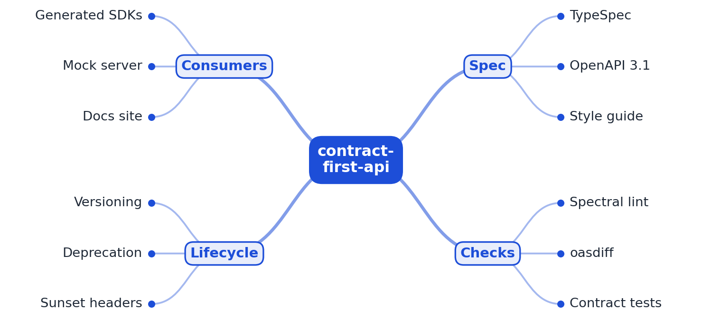

# RFC 0001: contract-first-api design

- **Status:** Accepted (M1 implemented)
- **Author:** EquinoxWN
- **Created:** 2026

## Problem (Define)

Most HTTP APIs are written code-first: the handlers come first and the OpenAPI document, if any,
is exported from them afterwards. Clients find out about a change when their calls fail. Three
kinds of defect keep recurring:

1. **Inconsistent shape.** One team names fields `created_at`, another `createdAt`; one list
   endpoint pages with `offset`, another returns everything; errors arrive as `{"error": "..."}`,
   `{"message": ...}` or HTML. Every client needs special cases, and SDK generators produce
   awkward method names (`Orders_list`).
2. **Drift.** The published spec no longer matches what the team designed, because someone edited
   the generated file or forgot to regenerate it.
3. **Breaking changes.** A removed field or a narrowed type reaches production and breaks every
   client at once.

The fix is to design the contract first, in a language made for it, and to make every deviation
from the house style and every breaking change fail CI before review. M1 covers defects 1 and 2;
breaking-change detection (defect 3) is M2.

**Users:** API designers and backend teams who own a public or internal HTTP API, platform teams
who want one style across many APIs, and client teams who consume them.

### Critical-to-quality measures

| CTQ | Measure | Target | M1 result |
|---|---|---|---|
| Spec follows the style guide | house-rule errors and Spectral warnings in the committed OpenAPI file | 0 | 0 errors, 0 warnings ([results](../results/m1.md)) |
| Spec and design never drift | committed `openapi/openapi.yaml` differs from a fresh TypeSpec compile | 0 files | 0; CI gate `make check` |
| Violations are caught | seeded style violations detected, one kind per house rule | 100 % | 140/140 |
| No false alarms | findings on the compliant spec and a minimal compliant document | 0 | 0 |
| Fast feedback | TypeSpec compile plus lint, median on the author's laptop | < 2 s | 107 ms + 55 ms |
| Safe on hostile input | external `$ref`s fetched, alias bombs expanded, files over 5 MiB read | 0 | 0 (tests) |

## Goals

- The example API (customers and orders of a small shop) is designed in TypeSpec and compiled to
  one OpenAPI 3.1 document, which is committed so reviewers and tools see the exact contract.
- A style guide covers naming (paths, operationIds, schemas, properties, query parameters),
  pagination (cursor, bounded `limit`, `{items, nextCursor}` envelope) and error format (RFC 9457
  problem details as `application/problem+json`), and is enforced by Spectral on the generated
  document, together with Spectral's recommended OpenAPI rules.
- One CLI, `contract`, runs the pipeline: `build` (compile and lint), `check` (fail if the
  committed file is stale, then lint), `lint` (any OpenAPI file), with GitHub annotations in CI.
- Later: oasdiff blocks breaking changes against the last release and SDKs, a mock server and a
  docs site are generated on release (M2); contract tests against a running server and
  `Deprecation`/`Sunset` headers (M3).

## Non-goals

- Running a production API server; M1 is the contract and its gates. A server arrives with the
  contract tests in M3.
- A general-purpose OpenAPI linter for every style: the house rules encode one opinionated style,
  and other teams change the ruleset rather than configure it.
- Following external `$ref`s across files or URLs: TypeSpec emits one self-contained document,
  and refusing remote references keeps linting free of network and file access.

## Proposed design



```
spec/main.tsp + spec/lib/style.tsp ──TypeSpec 1.16 (warnings are errors, @typespec/http linter)──►
   in-memory OpenAPI 3.1 ──► contract build: write openapi/openapi.yaml
                         └─► contract check: byte-compare with the committed file (stale = fail)
openapi/openapi.yaml ──► load (5 MiB cap, strict UTF-8, one YAML document, unique keys,
                         ≤ 100 aliases, root has "openapi") ──► Spectral 1.24
                         (spectral:oas recommended + 13 house rules, no external $ref resolver)
                     ──► findings: text | json | GitHub annotations; exit 0 / 1 / 2
```

| Part | M1 implementation |
|---|---|
| Design language | TypeSpec with `@typespec/http` and `@typespec/openapi`; `spec/lib/style.tsp` holds `PageParameters`, `Page<T>`, `ProblemDetails` and named error responses, so following the style is the easy path |
| Emitter | `@typespec/openapi3` with `openapi-versions: [3.1.0]`, `operation-id-strategy: explicit-only`, LF line endings; config in `tspconfig.yaml` |
| Drift check | The compiler runs with a host whose `writeFile` captures output in memory; `check` compares it with the committed file without touching disk |
| Style guide | `src/ruleset.ts`: 13 rules, typed in TypeScript; custom functions in `src/functions.ts` for path casing, list pagination and error format; each rule links to its section in `docs/style-guide.md` |
| Input safety | `src/load.ts` bounds and validates input before Spectral parses it; Spectral gets a `$ref` resolver with no readers, so `http:` and `file:` references become `invalid-ref` errors |
| Proof | `src/mutations.ts` breaks the compliant spec in 14 seeded ways (at least one per rule); tests and `make bench` check each is caught |

## Alternatives considered

| Option | Why not (yet) |
|---|---|
| Code-first (annotations in a framework, export OpenAPI) | The contract follows the implementation, so it changes whenever the code does and review happens too late; the problem statement is exactly this. |
| Hand-written OpenAPI YAML as the source | Works with the same linter, but the 519-line YAML file for eight operations is hard to review, and shared shapes (pages, errors) are copy-pasted rather than reused. TypeSpec templates make the style the default. |
| Spectral CLI with a YAML ruleset (`.spectral.yaml`) | The usual setup. Custom functions would still be JavaScript files without types, rules and their docs could drift apart silently, and `@stoplight/spectral-cli` adds dependencies M1 does not need. See [ADR 0003](../adr/0003-spectral-ruleset-in-typescript.md). |
| Lint TypeSpec only (TypeSpec linter rules) | Catches problems at design time, but not in specs written by hand or by other tools, and depends on emitter behaviour (the dotted schema names found in M1 come from the emitter, not from the TypeSpec source). M1 runs the TypeSpec `http` linter and lints the output. |
| Redocly CLI or Vacuum instead of Spectral | Comparable rule engines; Spectral's ruleset format is the most widely shared and its functions are plain TypeScript-compatible JavaScript. Revisit if lint time grows (55 ms median in M1). |

## Measurement plan

- **Measure:** compile the first draft of the API (written with TypeSpec defaults, kept as
  `test/fixtures/draft/`) and the final spec, lint both, count findings by area; time compile and
  lint (median of five); run 140 seeded violations (14 kinds × 10 seeds) and count detections.
  All of it is `make bench` (`src/measure.ts`), printed to the CI job summary.
- **Control:** `make ci` runs strict `tsc`, `tsp format --check`, `contract check` (stale file or
  any finding fails) and 37 tests; `npm audit` must report 0 vulnerabilities.
- **M3 proof:** a pull request where CI catches a breaking change, and the generated docs site.

## Milestones

- **M1:** The API is designed in TypeSpec and compiled to OpenAPI 3.1. Spectral enforces the style guide.
- **M2:** oasdiff compares the spec with the last release and fails CI on breaking changes. SDKs, a mock server and a docs site are generated on every release.
- **M3:** Contract tests check that the running server matches the spec. Deprecated endpoints return Deprecation and Sunset headers.

## Risks and open questions

- **Emitter changes:** a TypeSpec upgrade can change the generated file (ordering, descriptions).
  `make check` makes that visible as a diff in the upgrade pull request rather than in production;
  Dependabot groups the `@typespec/*` packages so they move together.
- **Rule false positives:** the list-operation rule treats every `GET` on a path that does not end
  in a parameter as a collection. A singleton resource such as `/me` would be flagged; the fix
  would be an explicit marker (an `x-` extension) rather than a looser heuristic.
- **OpenAPI 3.2:** `cfa-openapi-3-1` rejects 3.2 documents on purpose until the generators used in
  M2 support it.
